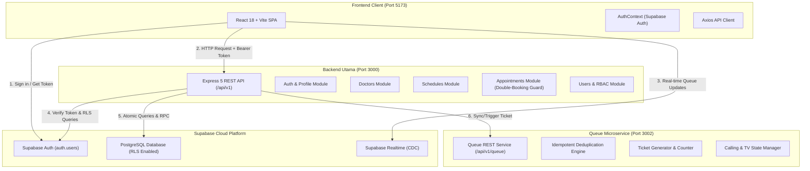

# Arsitektur JanjiCare — Node.js & Supabase Microservices

## 1. Ikhtisar Arsitektur

JanjiCare adalah platform manajemen klinik dan pemesanan janji temu konsultasi dokter yang dibangun dengan arsitektur modern berbasis layanan terdistribusi (microservices-ready), memigrasikan backend lama (PHP/Laravel) ke **Node.js (Express 5)** dengan database **Supabase PostgreSQL**.

---

## 2. Komponen Sistem

### 2.1. Frontend (`janjicare-frontend`)
- **Port:** 5173
- **Teknologi:** React 18, Vite, TypeScript, Tailwind CSS 3, React Router v6, Axios, Lucide React, Supabase JS SDK.
- **Autentikasi:** Langsung berinteraksi dengan Supabase Auth untuk pembuatan session dan pertukaran token JWT, dilanjutkan dengan request ber-Bearer token ke Backend Express.
- **Desain & Aset:** 100% mempertahankan desain UI visual, komponen layout (Admin, Dokter, Pasien), palet warna teal-emerald, dan navigasi.

### 2.2. Backend Utama (`backend`)
- **Port:** 3000
- **Teknologi:** Node.js, Express 5, ES Modules, Helmet, CORS, Morgan, Express Rate Limit, Zod.
- **Struktur Modular:**
  - `modules/auth`: Registrasi, Login backend, Logout session, Profil (`/me`, `/profile`).
  - `modules/doctors`: CRUD data dokter, filter spesialisasi, pencarian nama.
  - `modules/schedules`: Pengelolaan jadwal praktik, kapasitas harian, filter tanggal.
  - `modules/appointments`: Alur booking janji temu, pencegahan double-booking, kapasitas, pembatalan.
  - `modules/users`: Manajemen pengguna dan verifikasi role untuk Administrator.

### 2.3. Queue Microservice (`services/queue-service`)
- **Port:** 3002
- **Tanggung Jawab:**
  - Pengelolaan nomor antrean pasien per dokter dan per tanggal.
  - Pemanggilan antrean (`waiting` $\rightarrow$ `calling` $\rightarrow$ `serving` $\rightarrow$ `done`).
  - Idempotent request handling: request berulang untuk appointment yang sama tidak akan melahirkan tiket ganda.
  - Kegagalan Queue Service tidak membatalkan data booking pasien di Supabase.

### 2.4. Supabase Database & Security (RLS)
- **Engine:** PostgreSQL 15+.
- **Tabel Utama:**
  - `profiles`: Berelasi 1:1 ke `auth.users(id)`. Menyimpan nama, role (`admin`, `doctor`, `patient`).
  - `doctor_details`: Detail spesialisasi dan bio dokter.
  - `doctor_schedules`: Jadwal praktik dan kapasitas maksimal harian.
  - `appointments`: Transaksi booking pasien dengan status periksa.
- **Keamanan Database:**
  - Row Level Security (RLS) aktif pada semua tabel.
  - Policy mencegah user biasa mengubah role sendiri menjadi admin.
  - Stored Procedure `book_appointment_atomic()` dengan `SELECT ... FOR UPDATE` mengunci baris jadwal secara atomik untuk mencegah race condition double-booking.

---

## 3. Strategi Ketahanan Sistem & Pemulihan (Fault Tolerance)

| Kasus Kegagalan | Dampak | Penanganan & Strategi Pemulihan |
|---|---|---|
| **Queue Service Offline** | Pasien tetap berhasil membuat appointment di backend utama. | Backend menyimpan status booking di PostgreSQL. Saat Queue Service kembali menyala, backend/worker dapat me-replay pembuatan tiket antrean (idempotent). |
| **Request Jaringan Berulang** | Risiko tiket antrean terbit ganda. | Queue Service menggunakan indeks memori `appointmentToTicket` untuk mengembalikan tiket yang sama jika request diulang. |
| **Concurrent Booking Over-Capacity** | Risiko 2 pasien booking di slot terakhir bersamaan. | PostgreSQL function `book_appointment_atomic()` melakukan locking `FOR UPDATE` di tingkat baris tabel jadwal. Request kedua otomatis ditolak dengan kode `409 Conflict`. |
| **Token Kedaluwarsa** | Request API ditolak (401). | Axios interceptor di frontend secara otomatis meminta refresh token ke Supabase Auth sebelum mengirim request. |
